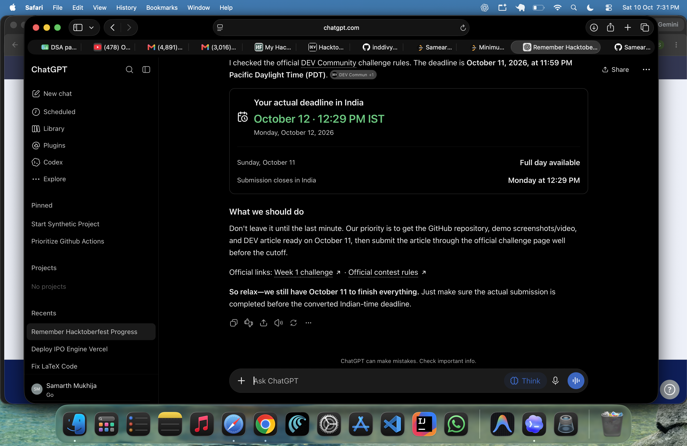
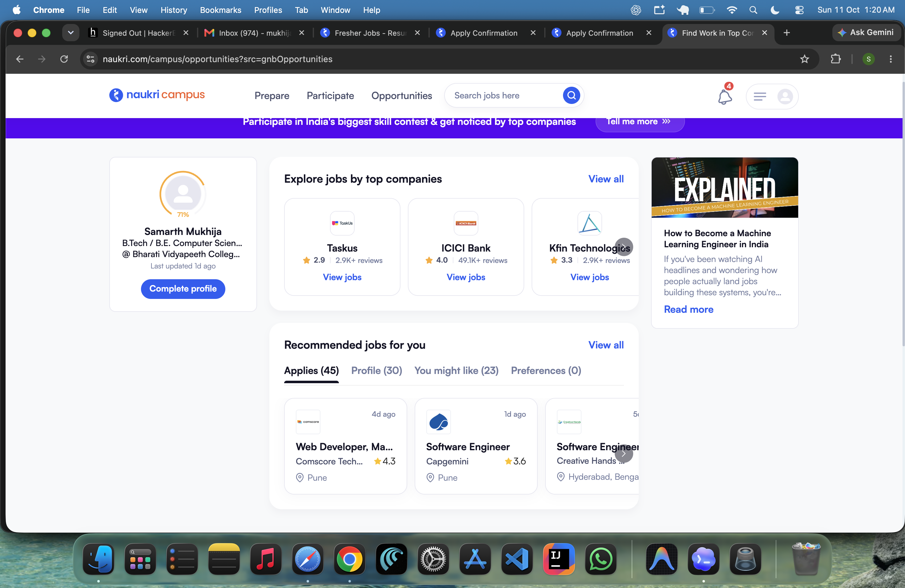

# FieldLens AI: a local-first nudge to put the phone away

> Draft for DEV Community — do not publish automatically. Suggested tag: `#hf26challenge`.

Most nature apps add another feed, map, account, or notification layer. FieldLens AI takes the opposite approach: choose how long you have, where you are, and what you are curious about; get one bounded observation mission; then put the phone away and return to a private journal.

Repository: https://github.com/Samearth17/fieldlens-ai

## The problem

Urban nature is available to many of us, but starting can feel vague. “Go outside” is good advice and a hard task. FieldLens turns that blank slate into a small, safe prompt without requiring location tracking, an account, or a cloud AI service.

## What I built

The web app is a FastAPI backend with an HTML, CSS, and vanilla JavaScript frontend. A mission can be 15, 30, or 60 minutes, and can focus on a park, neighborhood, garden, or woodland. Interests include plants, birds, insects, trees, and general biodiversity.

After a mission is generated, the screen-free mode shows a simple timer and tells the explorer that the screen can wait. The field journal is deliberately browser-local: entries are saved in `localStorage`, can be edited or deleted, and remain after a reload. They are not sent to the server and `localStorage` is not encrypted storage.







The interaction recording is available in the repository as [docs/demo.mp4](demo.mp4) when screen-recording permission is available. The screenshots above are genuine captures of the running app, not mockups.

## How the local AI works

The first model-backed request lazily initializes a cached Hugging Face Transformers pipeline using `google/flan-t5-small`. The API bounds the prompt and generated length, asks for a compact labeled format, validates the returned title and steps, rejects unsafe or malformed content, and adds fixed safety guidance. The model is never loaded during app startup.

There is also a deliberately honest fallback. Set `FIELDLENS_DISABLE_MODEL=1`, or let an initialization, download, timeout, memory, or validation error occur, and the API returns a deterministic curated mission with `source: "fallback"`. A successful model response is marked `source: "local_model"`. The interface repeats that distinction so a fallback is never presented as AI output.

This is useful for demos and for resilient local software, but it is not a claim that a small language model understands ecology. The official model card lists Apache 2.0, 77M parameters, and limitations including bias and lack of real-world testing: https://huggingface.co/google/flan-t5-small. FieldLens does not identify species or make scientific claims from an observation.

## Run it yourself

```bash
cd "week 2/fieldlens-ai"
python3 -m venv .venv
source .venv/bin/activate
python -m pip install -r requirements-dev.txt
FIELDLENS_DISABLE_MODEL=1 uvicorn app.main:app --host 127.0.0.1 --port 8000
```

Open http://127.0.0.1:8000. To try local inference, omit `FIELDLENS_DISABLE_MODEL=1`; the first request needs internet access to download the model, and later requests use the local Hugging Face cache. No API key is required.

Run the checks with:

```bash
pytest -q
python -m compileall -q app tests
node --check app/static/app.js
```

The API exposes `GET /api/health` and `POST /api/missions/generate`; interactive documentation is at `/docs`.

## Privacy and safety choices

There is no GPS, account, analytics, advertising, or external journal endpoint. Observe wildlife without touching, feeding, collecting, chasing, or disturbing it. Stay on permitted routes, check weather and footing, and follow local guidance. The app is an exploration prompt, not medical, legal, or scientific advice.

## What I learned and what remains

The most important engineering lesson was treating model output as untrusted input. A local model can be unavailable or surprisingly formatted, so the product needs bounded prompts, validation, a safe fallback, and honest status reporting before it needs a more ambitious model.

Remaining improvements include broader accessibility testing with assistive technology, more varied hand-authored missions, a richer offline install experience, and evaluation of model-generated missions with human reviewers. None of those are represented as completed or measured here.

Open-source AI matters for this project because the core generation path can be inspected, run locally after the first download, and used without sending journal content to a paid inference API. That control comes with real costs: model downloads, hardware constraints, quality limitations, and the responsibility to communicate them clearly.

## Demo walkthrough

1. Open the homepage and choose “Plan an outdoor mission”.
2. Select a duration, environment, and interest, then generate a mission.
3. Start screen-free mode and complete the mission.
4. Save an observation, reload the page, and edit or delete it from the journal.
5. Check the health status and confirm whether the source is `local_model` or `fallback`.

The project is prepared for review, but this article is intentionally only a draft. Publish it yourself after checking the current challenge deadline, adding the final video link if needed, and confirming the screenshots render correctly on DEV.
